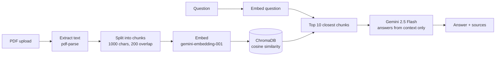

# AskMyPDF — RAG System

Upload PDFs, ask questions, and get answers grounded in your documents, with the source chunks shown under every answer.

Built as a from-scratch Retrieval-Augmented Generation (RAG) pipeline: no LangChain, just the steps.

<!-- TODO: add a screenshot or demo GIF -->

## How it works



1. **Upload.** PDFs up to 10 MB are parsed and cleaned.
2. **Chunk.** Text is split into 1,000-character chunks with 200 characters of overlap, so ideas aren't cut in half.
3. **Embed and store.** Each chunk is embedded with `gemini-embedding-001` and stored in ChromaDB in batches of 100.
4. **Retrieve.** A question is embedded the same way and the 10 closest chunks are pulled by cosine similarity.
5. **Answer.** Gemini 2.5 Flash answers using **only** those chunks, and says so when the documents don't contain the answer.

The embedding client retries on rate limits (HTTP 429) using the wait time the API returns.

## Tech stack

Next.js 16 (App Router) · React 19 · TypeScript · Tailwind CSS 4 · ChromaDB · Google Gemini (embeddings + generation) · pdf-parse

## Run it locally

Requirements: Node.js 20+, a [Gemini API key](https://aistudio.google.com/app/apikey), and a running ChromaDB server.

```bash
# 1. Start ChromaDB (Docker)
docker run -p 8000:8000 chromadb/chroma

# 2. Install and configure
git clone https://github.com/Ali-mohamed843/AskMyPDF-RAG-System.git
cd AskMyPDF-RAG-System
npm install
```

Create `.env.local`:

```env
GEMINI_API_KEY=your_key_here
CHROMA_URL=http://localhost:8000
```

```bash
# 3. Run
npm run dev
```

Open http://localhost:3000, upload a PDF, and ask a question.

## API routes

| Route | What it does |
| --- | --- |
| `POST /api/upload` | Parse, chunk, embed and store a PDF |
| `POST /api/ask` | Answer a question from the stored chunks |
| `POST /api/reset` | Clear the vector store |

## Project structure

```
app/            pages and API routes
components/     upload form, question form, answer display
lib/            pdfProcessor, embeddingClient, vectorClient, geminiClient
types/          shared types
```
